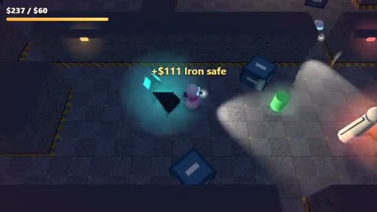

# Scrap Haul

Grab the scrap. Make quota. Don’t look away. A multiplayer starter game from [Multiplayer Agent](https://multiplayeragent.com): 3D, co-op, 1–4 players, with bot crewmates that fill empty seats.

## How it plays

Your crew lands at a dead facility to haul scrap back to the ship before it leaves at dusk. Heavy loot pays more but slows you down. Keep your flashlight on the pale one, walk quietly past the blind one, and remember: whoever dies drops their loot.

Make the day's quota and you land again tomorrow, with more scrap, more monsters and a bigger quota. Miss it and you're fired.

- **The Watcher** only moves while no flashlight is on it.
- **The Hound** is blind: it rushes at noise (running, heavy steps, dropped scrap) and only bites what moves. Freeze.
- **The Crawler** patrols and chases anyone it sees. A lit flashlight is easy to see.

**Controls:** WASD to walk, mouse to aim the flashlight, E or click to grab and drop, Shift to run, F for the light, or the touch stick and buttons.

## Make it yours in the Game Builder

Open the [Game Builder](https://multiplayeragent.com), choose **Start from a starter game** and pick Scrap Haul. It opens as version 1 in your studio, ready to play and publish. Then ask for changes, for example:

- Add a shop on the ship to buy a better flashlight
- Make a monster that mimics a crewmate
- Add a rainy day where the Hound hears twice as far

## Run it yourself

1. Get a free publishable key (`pk_…`) at [multiplayeragent.com](https://multiplayeragent.com).
2. In `index.html`, put it in place of `pk_REPLACE_ME` in the `MP_CONNECT` block.
3. Serve the folder (it's a 3D game, so it loads three.js from `libs/`), for example with `npx serve`, and open it in a browser.

Without a key it still runs, offline with bot crewmates.

## How it is built

- One `index.html` plus three.js in `libs/`. The comment at the top of the script maps the code and explains the multiplayer.
- **Host-run rules:** The host's browser runs the day clock, the monsters and who picks up what; if it leaves, the next player takes over.
- **Bots:** Bot crewmates scavenge, haul and run from monsters until friends join.
- **Rounds:** Each day lands, ends and checks the quota together for everyone.
- **Leaderboard:** The most scrap a crew hauled before getting fired.
- `?attract` runs it offline with bots only. The preview video is recorded from it.

## License

MIT.
